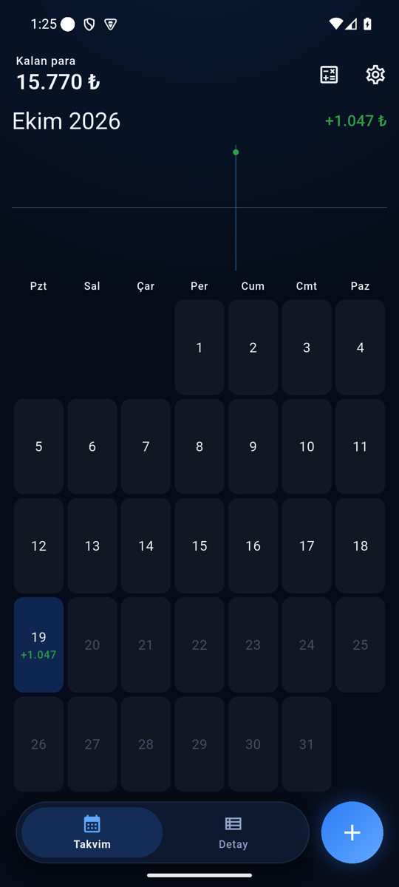
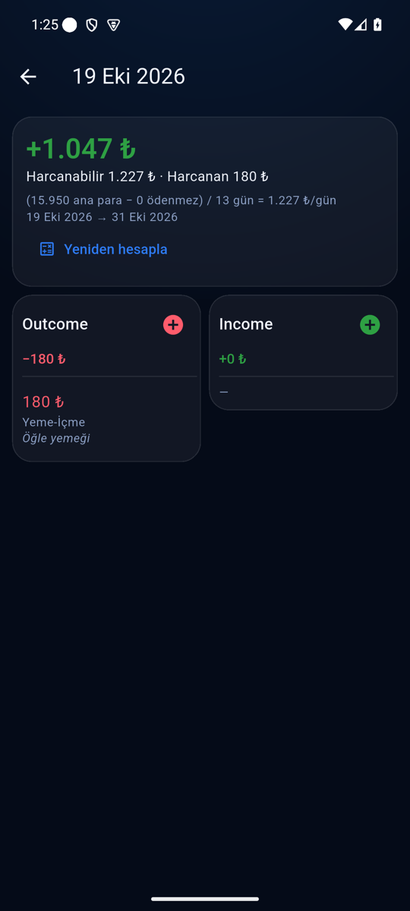
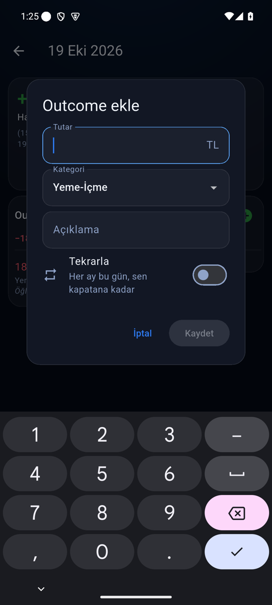
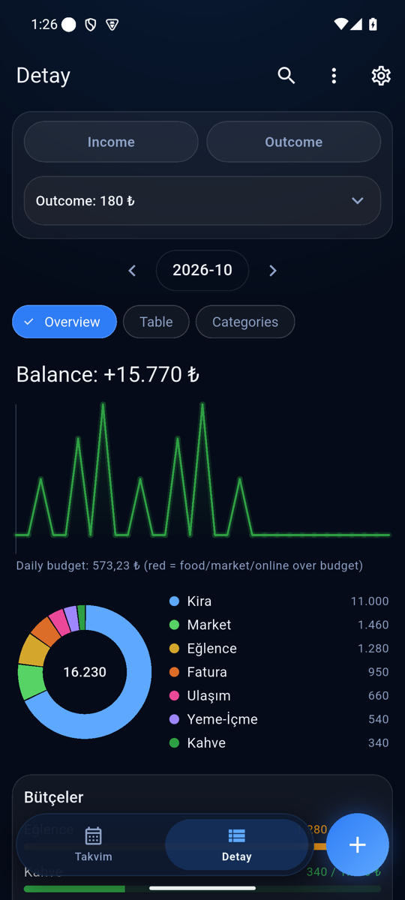
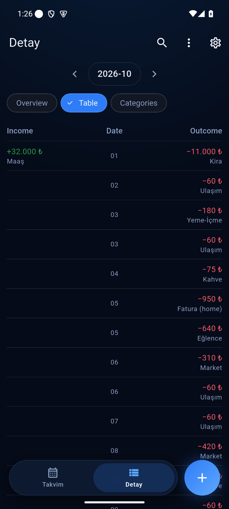
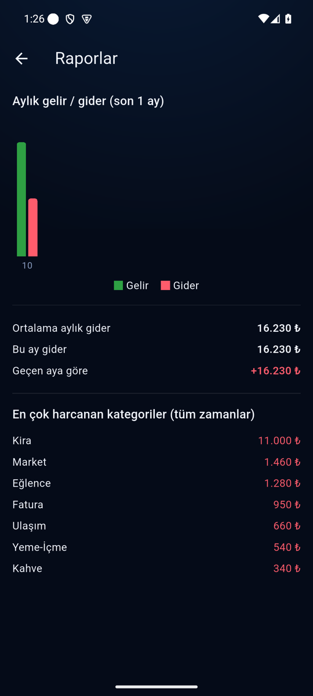
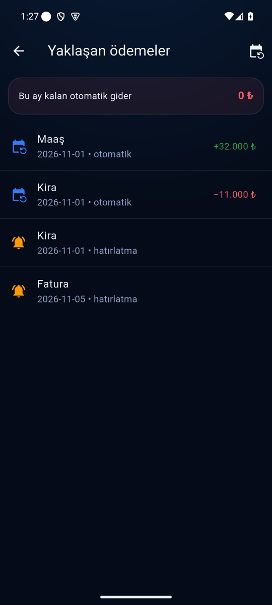
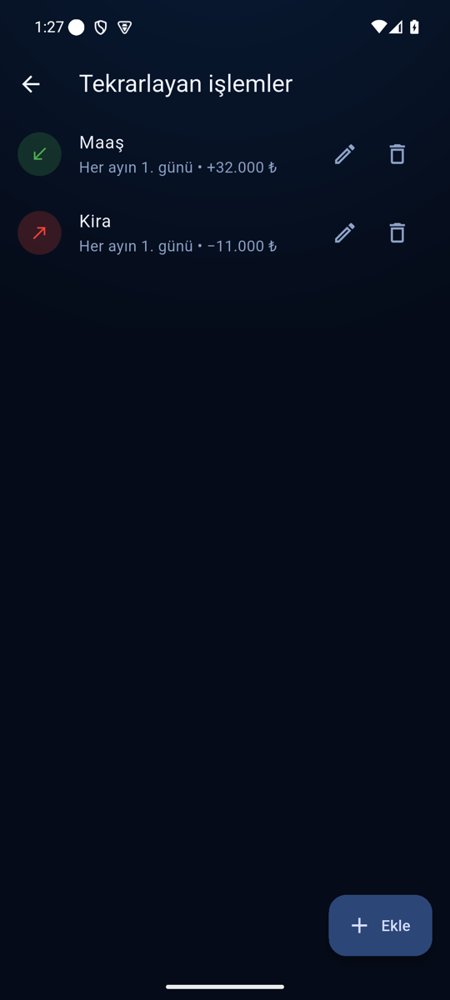

# 1B$ — Para

Local, offline Android money tracker (Flutter). One month per screen, each
day shows whether it ended plus or minus against the daily spendable amount:

    günlük harcanabilir = (ana para − ödenmezler) / süre

- **ana para** — every income minus every outcome entered.
- **ödenmezler** — rent, bills, subscriptions (recurring). If the previous one
  was paid, the next one is ignored until 5 days before its due date.
- **süre** — days until the next expected income, else until month end.
- Overspending a day is deducted from the following day(s); a recalculate
  button restarts the daily amount from today.

Data stays on the device in an encrypted SQLite database. See HARNESS.md.

## Screenshots

| Month | A day | Add an entry | Details |
|---|---|---|---|
|  |  |  |  |

| Table | Reports | Upcoming payments | Recurring |
|---|---|---|---|
|  |  |  |  |

All screenshots use made-up demo data ([`tool/screenshots/`](tool/screenshots/)).

**Download:** the latest APK is on the
[Releases page](https://github.com/DenizTanisman/local_harness_money/releases/latest)
(Android 8+, install it and allow "unknown sources").

**Huawei Watch GT 5 quick entry** — a small watch app in [`watch/`](watch/)
sends income/outcome entries to Para over Huawei Wear Engine.

```sh
flutter pub get
flutter test
flutter build apk
```
